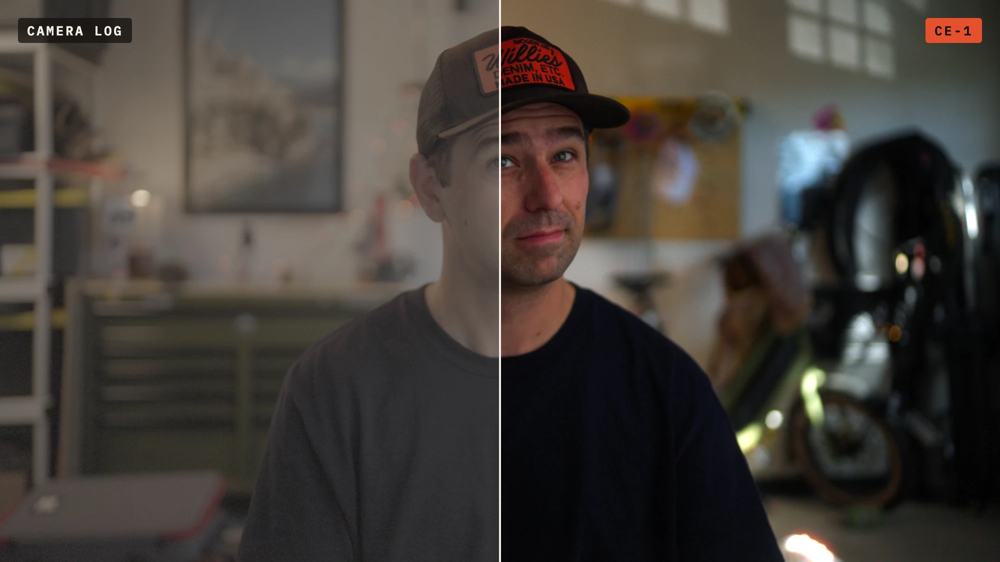

# CE-1™ Film Emulation

A film emulation OpenFX plug-in for **DaVinci Resolve** on Mac: a spectral film engine
built from published film stock data (negative, print and slide film), halation that finds
the light, gauge-accurate grain, film softness and gate weave, built natively around your
camera's own log format. $79.99 one-time for Mac, with a free trial:
[tresmediaco.com/ce-1](https://tresmediaco.com/ce-1). Final Cut Pro version in development;
Windows support coming soon.

## Download

**[Download the latest version](https://github.com/karl381/ce-1/releases/latest/download/CE-1-Film-Emulation.dmg)**
(signed and notarized by Apple). All versions and release notes are on the
[Releases page](https://github.com/karl381/ce-1/releases).

- [User Guide (PDF)](https://github.com/karl381/ce-1/releases/latest/download/CE-1-User-Guide.pdf)
- [Best Practices (PDF)](https://github.com/karl381/ce-1/releases/latest/download/CE-1-Best-Practices.pdf)

## Requirements

- Mac with Apple Silicon or Intel, macOS 12 Monterey or later
- DaVinci Resolve with OpenFX plug-in support (tested with Resolve Studio 21.1)

## Support

karl@tresmediaco.com: please include your Mac model, macOS and Resolve versions, the camera
format and a screenshot of the CE-1 settings.

## Licence

CE-1 is commercial software: try it free with a watermark, then buy a license to remove it.
Use is subject to the [License Agreement](LICENSE.txt). This repository hosts releases only;
CE-1's source code is not published.

CE-1 is a trademark of Tres Media Co. DaVinci Resolve is a trademark of Blackmagic Design.
Final Cut Pro is a trademark of Apple Inc. Camera and log format names are trademarks of their
respective owners. CE-1 is not affiliated with or endorsed by any of them, or by any film
manufacturer.
